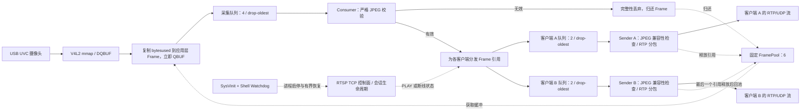

# 基于 i.MX6ULL 的 Embedded Linux 低延迟多媒体传输系统

## 项目简介

本项目面向资源受限的嵌入式 Linux 平台，在用户态实现 USB 摄像头 MJPEG 采集、
JPEG 完整性过滤、RTP/JPEG 分包及 RTSP 会话管理，支持最多两个客户端同时播放。

工程重点是采集缓冲归还、应用层帧所有权、有界队列、慢客户端隔离，以及服务的持久化部署、
开机启动和异常退出恢复。板端媒体链路不依赖 FFmpeg 或 GStreamer；Ubuntu 侧使用
FFmpeg/ffplay 进行解码播放和互通验证。

正式工程 M9 最终验收为 **CONDITIONAL PASS（有条件通过）**。本仓库保留验收边界，
不将历史实机结果直接视为公开适配版本的完整硬件验收。

| 版本 | 用途与边界 |
| --- | --- |
| 正式 M7.2 Release：`m7.2-20261013-r1` | 已冻结的板端运行版本，配套 M7.4 SysVinit/Watchdog；已有实机验收记录 |
| GitHub 公开适配版本 | 提供独立 CMake 入口、合成 JPEG 测试样本及离线测试；Huffman 匹配与 DHT 输出实现已重新设计，接口与输出行为保持兼容，但不与冻结版本混为一谈 |

项目自有代码采用 [MIT LICENSE](LICENSE)。RFC 2435 派生的标准参数保留历史授权条件，
分发时需同时保留[第三方声明](THIRD_PARTY_NOTICES.md)。

## 硬件与软件环境

| 项目 | 配置 |
| --- | --- |
| 开发板 | ATK i.MX6ULL，ARM Cortex-A7，约 512 MB RAM |
| 板端系统 | Linux 4.1.15、glibc 2.23、SysVinit |
| 摄像头 | Hikvision DS-E12 USB UVC Camera |
| 采集模式 | `/dev/video2`，MJPEG，1280×720，目标 30 fps |
| 实测帧率 | 正常模式约 29 fps，不保证恒定 30 fps |
| 板端开发语言 | C++11，兼容原有 Poky GCC 5.3 工具链 |
| 交叉编译 SDK | `/opt/fsl-imx-x11/4.1.15-2.1.0/` |
| 客户端与验证环境 | Ubuntu 22.04，FFmpeg/ffplay、CMake、g++、Python 3、POSIX/GNU 工具 |

摄像头驱动和板端系统沿用现有环境。本项目不包含 Linux 驱动、Kernel/BSP 开发或编解码器实现。

## 系统架构



FramePool 在 JPEG 校验前提供应用层缓冲；校验通过后才进行媒体分发。
V4L2 mmap 指针不直接交给异步发送线程。多客户端共享应用层 Frame，
通过引用管理确保最后一个使用者释放后才能回池。

图中虚线表示资源归还或控制关系，RTSP、SysVinit 和 Watchdog 不是逐帧处理模块。
所有 Frame 归还仍受统一所有权规则约束，丢弃队列帧也必须释放对应引用。
详见[架构说明](docs/architecture.md)和[源码来源与公开适配说明](docs/provenance.md)。

## 核心功能与实现

### V4L2 采集与 JPEG 完整性过滤

- 使用 V4L2 mmap 完成 QBUF、STREAMON、DQBUF 等采集流程。
- DQBUF 后将 `bytesused` 复制到预分配的应用层 Frame，再立即 QBUF 原驱动缓冲。
- 严格检查 JPEG：长度不少于 4 字节，开头为 `FF D8`，最后两个有效字节为 `FF D9`。
- 坏帧单独计入 integrity drop，不交给媒体 Sink；不修补、不裁剪，也不放宽校验条件。

### 帧引用、有界队列与双客户端隔离

- FramePool 固定为 6 个槽位，采集队列容量为 4，每客户端发送队列容量为 2。
- 队列满时采用 drop-oldest，释放最旧帧对应的所有权或引用，避免无界积压。
- 共享采集与 Consumer 路径，各客户端拥有独立发送队列、线程和 UDP socket。
- 慢客户端在自己的队列中丢帧，不等待其处理完成再继续分发给正常客户端。
- 分别统计完整性丢弃、采集队列丢弃、客户端发送队列丢弃、池耗尽和引用回收情况。

### RTP/JPEG 与 RTSP

- 支持 Baseline、单次交错扫描、4:2:0、标准 Huffman 表、无 restart 的 JPEG 子集。
- RTP/JPEG 使用 type 1、Q=255，首包携带两张量化表；分片内容为熵编码扫描数据，
  不是对整个 JFIF/JPEG 文件直接切片。
- 使用 90 kHz RTP timestamp，同帧分片使用相同时间戳，sequence 逐包递增，
  仅最后一包设置 marker。
- UDP socket 非阻塞，发送节奏、重试和单帧预算均有上限。一帧失败后放弃其剩余分片，
  不在该帧发送中途混入另一帧。
- 正常配置为 `udp-gap-us=10`、`udp-frame-budget-ms=100`。
  **100 ms 是发送阶段的单帧预算，不是端到端延迟上限。**
- RTSP 控制面管理连接、SETUP、PLAY 和断线回收，支持最多两个客户端。

UDP 发送成功仅表示数据报已提交本机内核，**不表示网络送达或客户端解码成功**。

### 持久化部署与服务管理

- 发布目录位于 `/opt/lp2-media/releases/<version>`，由 `current` 指向审核后的版本。
- 通过 SHA-256 校验、受保护的版本切换和回滚工具管理发布，不覆盖冻结历史版本。
- SysVinit 管理服务启停，使用 PID、启动 tick 和 executable 精确校验进程身份。
- 独立 Shell Watchdog 检测已确认的进程退出，尊重管理员 stop，并在连续故障时限频锁定。
- 诊断和恢复日志有大小边界；Watchdog 不负责判断画面是否冻结或媒体是否仍有效。

服务无 RTSP 认证，通常监听全部 IPv4 接口；仅用于可信、隔离的实验网络，不应直接暴露到公网。
安装前阅读[部署说明](docs/deployment.md)，不要仅为运行原生单元测试而以 root 执行部署脚本。

## 编译与运行

### Ubuntu 原生构建

依赖 CMake 3.13 及以上版本、g++、Python 3、Linux V4L2 头文件及 POSIX/GNU 工具。
原生构建使用未激活 Poky SDK 的终端：

```bash
cmake -S . -B build/native -DCMAKE_CXX_COMPILER=/usr/bin/g++ \
  -DCMAKE_BUILD_TYPE=Release -DBUILD_TESTING=ON -DLP2_BUILD_TOOLS=ON
cmake --build build/native -- -j2
ctest --test-dir build/native --output-on-failure
```

服务目标为 `lp2_m5_rtsp_server`，可选工具包括 JPEG 检查器和 RTP/JPEG 接收端。
普通 Ubuntu 主机不需要运行依赖板端摄像头的服务来验证构建；离线测试不打开摄像头。

### 独立副本与离线验收入口

```bash
bash tools/validate_ubuntu.sh
```

该脚本按白名单导出独立临时副本，执行原生构建、6 项 CTest、合成 JPEG 实际解码和
Python 离线回归。JPEG 解码检查需要 FFmpeg。脚本不连接开发板、不部署、不启动服务，
证据保留在唯一的临时目录中。

### Poky ARM 交叉编译

```bash
bash tools/validate_poky.sh
```

脚本使用 `environment-setup-cortexa7hf-neon-poky-linux-gnueabi` 和
`cmake/toolchains/imx6ull-poky.cmake`，执行独立 ARM 构建及静态 SDK ABI 检查。
不打包 SDK、sysroot 或构建缓存，**禁止使用 Ubuntu 通用 ARM GCC 替代原 SDK**，
以免引入高于板端 glibc 2.23 的依赖。

Huffman 公开适配版本的组合验收入口：

```bash
bash tools/validate_huffman_revision.sh
```

该入口依次执行原生离线验收、ABI 检查器测试及 Poky 构建，不运行 ARM 程序或连接板端。
详见[构建说明](docs/build.md)、[测试说明](docs/testing.md)和[Huffman 替换记录](docs/huffman-replacement.md)。

### Ubuntu 客户端播放

以下地址为实验网络示例，实际使用时替换为目标板地址：

```bash
ffplay -rtsp_transport udp -fflags nobuffer -flags low_delay \
  -max_delay 0 -reorder_queue_size 0 -framedrop -sync ext \
  rtsp://192.168.50.2:8554/live
```

板端启动和安装步骤见[部署说明](docs/deployment.md)。公开源码构建通过并不等于可以直接替换
正在运行的正式版本；部署和版本切换仍需单独审核。

## 测试与验证

### 公开适配版本的构建与离线测试

以下结果来自维护者提供的验收记录，不是本次文档修改重新执行的测试：

| 检查项 | 结果 |
| --- | --- |
| Ubuntu 独立副本构建 | PASS，不依赖正式工程父目录 |
| CTest | 6/6 PASS |
| Python 离线回归 | 156/156 PASS：服务 64、Watchdog 21、发布工具 27、稳定性 24、双客户端 20 |
| 原生测试合计 | 162/162 PASS，包含上述 6 项 CTest 和 156 项 Python 测试 |
| ABI 检查器测试 | 9/9 PASS，单独计数 |
| Poky ARM 编译链接及静态 SDK ABI 检查 | PASS，不等于新增板端运行验收 |

两个版本的 ARM 程序 SHA-256 分别为：

```text
正式 M7.2 Release：
ad657b4177ca3ad882e7427677bce915d8a26642f1086023c7fa16dfaabddb35

GitHub 公开适配版本（Huffman 替换后）：
8b631abafc478e21e23e755d2676f5061bde8292df16c5bc552c4e27e3e84f46
```

公开版本哈希由维护者提供，本次未重新计算 ARM 二进制哈希；仓库不包含 ARM 发布产物、
SDK 或原始私有测试日志。

### 正式工程的历史实机验证

| 验证项 | 已记录结果 | 验收边界 |
| --- | --- | --- |
| 正常采集与播放 | 1280×720 MJPEG，约 29 fps | 不保证恒定 30 fps |
| 慢客户端隔离 | 正常 sender drop=0，慢 sender drop=1116，FramePool=6/6，ownership errors=0 | 特定受控背压实验 |
| 双客户端媒体独立性 | A 退出后，B 继续解码 30.002 秒，新增 855 帧 | 媒体独立性 PASS；完整 M9.3 自动验收仍为 INCONCLUSIVE |
| 长时间运行与重连 | 已有 30 分钟运行及顺序重连资源回收记录 | 不等于证明绝无泄漏，也不是公开构建的新实机验收 |
| 服务管理 | 已完成开机自启动、异常退出恢复、手动 stop/start、故障锁定与重置验收 | 不代表无缝播放或任意断电场景均安全 |

**M9 最终结论保持 CONDITIONAL PASS。**部分证据是维护者确认的汇总，未在仓库中附带完整原始日志。
详见[验证记录](docs/validation.md)及[公开发布检查表](docs/publication-checklist.md)。

## 已知限制

- **M9.3 完整自动验收为 INCONCLUSIVE**：缺少完整成对的后置身份检查和客户端数字退出码证据；
  后续辅助脚本修正不能替代缺失的实机验收。
- 两个 ffplay 窗口中关闭一个后另一个也退出的现象仍为 **OPEN**，根因未确认。
  无图形界面的 FFmpeg 媒体测试通过，不代表该窗口问题已修复。
- **M8 未证明显著的端到端延迟改善。**约 350～400 ms 仅为初步可见延迟观测，
  不是严格统计分布或延迟承诺；本项目不宣称硬实时。
- 非零拷贝：V4L2 mmap 数据会复制到应用层 Frame；RTP 解析和分包使用动态容器，
  不宣称全链路无动态分配。
- 严重丢包、乱序后，原播放器会话可能持续较大延迟，重新连接后恢复。
  未实现 RTCP、重传、FEC、TCP interleaved、认证、H.264 或音频。
- Watchdog 监测进程退出，不监测卡死画面或解码健康状态；不将其描述为完整媒体高可用方案。
- 仅验证指定 JPEG 子集及最多两个客户端，不是完整 RTSP 标准实现或通用转码系统。

更多边界见[已知限制](docs/limitations.md)与[延迟研究记录](docs/latency-research.md)。
