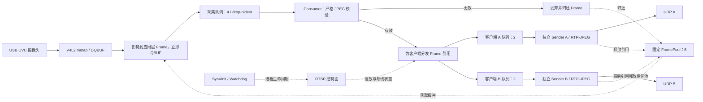

# 基于 i.MX6ULL 的 Embedded Linux 低延迟多媒体传输系统

## 项目简介

面向 i.MX6ULL 的用户态视频传输项目：通过 V4L2 采集 USB 摄像头 MJPEG，过滤不完整
JPEG，以 RTP/JPEG over UDP 发送，并通过 RTSP 管理最多两个客户端的播放会话。

重点实现采集与发送解耦、应用层帧所有权、有界队列、慢客户端隔离，以及持久化部署、
SysVinit 开机启动和 Watchdog 异常退出恢复。板端媒体链路不依赖 FFmpeg/GStreamer，
Ubuntu 侧使用 FFmpeg/ffplay 验证解码与播放。

## 开发环境

| 项目 | 配置 |
| --- | --- |
| 硬件 | ATK i.MX6ULL，ARM Cortex-A7，约 512 MB RAM |
| 板端系统 | Linux 4.1.15、glibc 2.23、SysVinit |
| 摄像头 | Hikvision DS-E12 USB UVC Camera，`/dev/video2` |
| 视频模式 | MJPEG，1280×720，目标 30 fps，正常实测约 29 fps |
| 开发工具 | C++11、CMake、Poky GCC 5.3 交叉工具链 |
| 客户端 | Ubuntu 22.04、FFmpeg/ffplay |

## 系统架构



FramePool 在 JPEG 校验前提供应用层存储，所有使用者释放引用后，Frame 才能回池。
图中实线表示媒体数据流，虚线表示缓冲归还与控制关系。帧所有权设计见[架构说明](docs/architecture.md)。

## 核心技术实现

- V4L2 采集：mmap 接收帧，DQBUF 后复制 `bytesused` 到预分配 Frame，立即归还驱动缓冲。
- 完整性过滤：检查长度、JPEG SOI 和有效数据末尾 EOI；坏帧单独计数，不修补、不送入媒体发送。
- 并发与背压：FramePool 为 6，采集队列容量 4，各客户端发送队列容量 2。
  队列满时 drop-oldest，并释放对应引用，避免无界积压。
- 多客户端分发：共享采集帧，各客户端独立队列、线程及 UDP socket。
  慢客户端仅在自身队列中丢帧，不等待其处理完成再服务其他客户端。
- RTP/JPEG：解析 Baseline 4:2:0 单扫描 JPEG，分片发送熵编码数据，
  首包携带量化表；使用 90 kHz 时间戳、逐包 sequence 和末包 marker。
- RTSP：管理请求、传输协商、PLAY 和连接回收；UDP 发送采用非阻塞 socket、
  有限重试及单帧发送预算。提交内核成功不等于网络送达。
- 运维：版本化发布目录、SHA-256 校验、受保护的切换与回滚；
  SysVinit 管理启停，Watchdog 按限频策略恢复异常退出，管理员 stop 后不自动拉起。

## 编译与运行

Ubuntu 原生构建使用未激活 Poky SDK 的终端：

```bash
cmake -S . -B build/native -DCMAKE_CXX_COMPILER=/usr/bin/g++ \
  -DCMAKE_BUILD_TYPE=Release -DBUILD_TESTING=ON -DLP2_BUILD_TOOLS=ON
cmake --build build/native -- -j2
ctest --test-dir build/native --output-on-failure
```

独立副本构建、JPEG 实际解码和离线回归入口：

```bash
bash tools/validate_ubuntu.sh
```

使用原有 i.MX6ULL Poky SDK 进行 ARM 构建和静态 ABI 检查：

```bash
bash tools/validate_poky.sh
```

不要使用 Ubuntu 通用 ARM GCC 替代原 SDK，以免引入高于板端 glibc 2.23 的依赖。
依赖和构建产物见[构建说明](docs/build.md)。

板端服务就绪后，Ubuntu 客户端可使用以下命令播放；IP 为实验环境示例：

```bash
ffplay -rtsp_transport udp -fflags nobuffer -flags low_delay \
  -max_delay 0 -reorder_queue_size 0 -framedrop -sync ext \
  rtsp://192.168.50.2:8554/live
```

板端安装、服务启停和版本回滚见[部署说明](docs/deployment.md)。
RTSP 未提供认证，仅用于可信实验网络，不应直接暴露到公网。

## 测试情况

| 项目 | 结果 |
| --- | --- |
| 原生构建与离线测试 | 独立副本构建通过，6 项 CTest 与 156 项 Python 测试通过 |
| 交叉编译 | Poky ARM 编译链接、静态 SDK ABI 检查及 9 项 ABI 检查器测试通过 |
| 正常采集播放 | 1280×720 MJPEG，约 29 fps |
| 慢客户端隔离 | 受控实验中正常客户端丢帧 0，慢客户端丢帧 1116；池最终 6/6，所有权错误 0 |
| 双客户端接收 | 一个客户端退出后，另一个继续解码 30.002 秒，新增 855 帧 |
| 稳定性与服务管理 | 已完成 30 分钟运行、重连、开机启动和异常退出恢复验证 |

测试方法、完整结果与已知问题见[验证记录](docs/validation.md)。

项目自有代码采用 [MIT LICENSE](LICENSE)，RFC 派生参数保留[第三方授权声明](THIRD_PARTY_NOTICES.md)。
