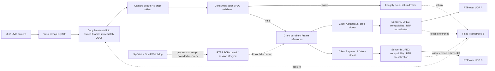

# i.MX6ULL RTSP/MJPEG Streaming

An embedded Linux **user-space** media project: capture UVC MJPEG, validate complete
frames, and stream RFC 2435 RTP/JPEG to up to two RTSP/UDP clients. C++11 on an
ARM Cortex-A7, with bounded queues, explicit ownership and SysVinit recovery.

Project-authored code is [MIT licensed](LICENSE). RFC-derived JPEG parameters
retain their publication-era terms; redistribute the [third-party notices](THIRD_PARTY_NOTICES.md).
Historical final acceptance is **CONDITIONAL PASS**, not an all-green product claim.

## Project Overview

Target: ATK i.MX6ULL, about 512 MB RAM, Linux 4.1.15, glibc 2.23, SysVinit.
Camera: Hikvision DS-E12 UVC, MJPEG 1280x720 at a requested 30 fps (about 29 fps
observed). The board does not use FFmpeg/GStreamer for its capture/streaming pipeline.
Independent Ubuntu FFmpeg/ffplay clients are used for interoperability and validation.
This is **not** a kernel driver/BSP, codec, hard-real-time or zero-copy project.

## System Architecture



The pool owns storage **before** validation; validation precedes fan-out and media
delivery. The resource/control arrows are not per-frame processing stages.
See [architecture](docs/architecture.md) for ownership and shutdown details.

## Key Engineering Features

- Preallocated application Frame payloads, immediate V4L2 buffer return and strict
  JPEG SOI/EOI filtering. No malformed input repair or silent acceptance.
- One shared capture/consumer path, fixed-slot references, two independent sender
  queues/threads/sockets. Slow clients drop their own oldest frames.
- Baseline single-scan 4:2:0 RTP/JPEG type 1, Q=255 with two quantization tables,
  90 kHz timestamps, per-packet sequence and final-packet marker. No whole-JFIF slicing.
- Nonblocking UDP with bounded retry/pacing. A failed frame's remaining fragments
  are abandoned; success means **submitted to the local kernel**, not network delivery.
- PID/start-tick/executable validation, immutable release directories, SHA approval,
  guarded current-link switching, SysVinit and rate-limited watchdog recovery.
- Protocol, reassembly, ownership and process/filesystem race tests, with a
  generated non-private JPEG instead of any camera photograph.

## Build and Test

On Ubuntu 22.04, use native CMake (3.13+), g++, Python 3 and POSIX tools. The
full offline command below also requires FFmpeg for a real decode check. It does
not contact a board, access a camera, start a service or inject network faults.

```bash
bash tools/validate_ubuntu.sh
```

It audits the source allowlist, exports a separate local clean copy, builds the
Linux server and optional native tools, runs six CTests, decodes the JPEG and
runs all Python offline suites. Evidence is retained in a unique temporary directory.
The independent Ubuntu build and162 tests passed (six CTests plus156 Python tests).
After the public Huffman replacement, the native162 tests, nine ABI-checker tests,
Poky ARM build and static SDK ABI checks passed according to the recorded
maintainer results. The replacement's maintainer-supplied ARM SHA-256 is
`8b631abafc478e21e23e755d2676f5061bde8292df16c5bc552c4e27e3e84f46`, distinct from M7.2.
See [replacement](docs/huffman-replacement.md)
and [validation](docs/validation.md). No board test is inferred from a host build.

For the board, use the existing Poky SDK and [cross-build instructions](docs/build.md).
No SDK, sysroot, executable, private Release or build cache is bundled. Do not use
Ubuntu's generic ARM GCC as a substitute for the glibc 2.23 target SDK.

## Deployment

Deployment is manual and requires an explicit review. The target layout is
`/opt/lp2-media/releases/<version>` with `current` pointing to the approved version.
`lp2-media` is a SysVinit service, **not systemd**; its separate shell watchdog
recovers confirmed process exits, respects administrator stop, and locks after
repeated failures. See [deployment](docs/deployment.md) before using any installer.

The service has no RTSP authentication and normally binds all IPv4 interfaces.
Use a trusted isolated laboratory network only. Never expose it directly to the
Internet or run deployment scripts with sudo merely to try the native unit tests.

Example lab client (the private IPv4 address is an example, not a credential):

```bash
ffplay -rtsp_transport udp -fflags nobuffer -flags low_delay \
  -max_delay 0 -reorder_queue_size 0 -framedrop -sync ext \
  rtsp://192.168.50.2:8554/live
```

## Validation Results

Historical hardware evidence, **not tests rerun by this source export**:

| Experiment | Observation | Boundary |
| --- | --- | --- |
| Normal capture/streaming | 1280x720 MJPEG, approximately 29 fps | Not a constant 30 fps guarantee |
| Slow-client isolation | Normal sender drop=0; slow sender drop=1116; pool=6/6, ownership errors=0 | One historical controlled-backpressure run |
| Dual-client media independence | After A exited, B decoded for 30.002 s and added 855 frames | Media PASS; full automatic M9.3 Gate INCONCLUSIVE |
| Resource monitoring | Historical 30-minute run and sequential reconnect resource observations | Not proof of zero leaks or a new public-build hardware gate |
| Service management | Reboot autostart, crash recovery, manual stop/start and fault lock/reset confirmed by user | Not seamless playback or arbitrary power-loss safety |

The final private-project acceptance remains **CONDITIONAL PASS**. Some results
are user-confirmed summaries rather than fully archived raw evidence. See
[validation](docs/validation.md), [testing](docs/testing.md) and [source provenance](docs/provenance.md).

## Known Limitations

- M9.3 full automatic Gate remains **INCONCLUSIVE**: paired post-check and numeric
  client exit evidence were missing. The later helper fix has no complete board Gate.
- Closing one of two ffplay windows was observed to close the other: **OPEN**,
  root cause unconfirmed. Headless FFmpeg success does not close this GUI issue.
- No significant end-to-end latency reduction was demonstrated by M8. Approximately
  350-400 ms is a preliminary visible-delay observation, not a rigorous distribution.
- Not zero-copy: mmap payloads are copied into application-owned Frames. Existing
  RTP parsing/packetization uses dynamic containers; no whole-path allocation-free claim.
- Severe loss/reordering may leave the original player delayed; reconnect restores
  playback. No RTCP, retransmission, FEC, TCP interleaving, authentication, H.264 or audio.

See [limitations](docs/limitations.md) and [latency research](docs/latency-research.md).
